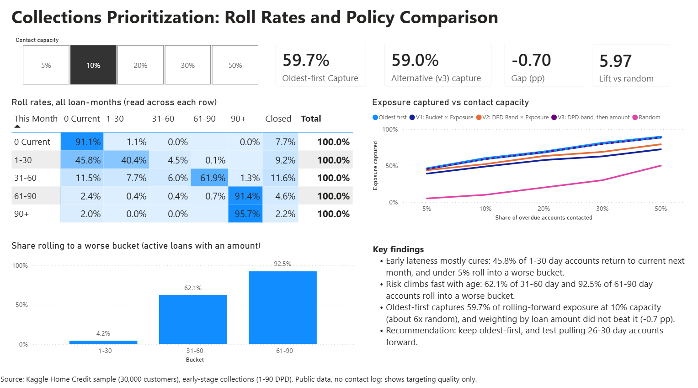

# Collections Prioritization Analysis

**Status: complete (v1).** The SQL pipeline, roll-rate analysis, backtest, Excel summary workbook and Power BI dashboard are done. Planned extensions are listed in the Roadmap.

## Problem
A lender has more overdue accounts than collection agents can contact. This project asks: if only a fraction of overdue accounts can be contacted, which should come first? It compares simple prioritization rules on historical data.

## Data
Kaggle *Home Credit Default Risk* (not included in this repo). Files used: `POS_CASH_balance.csv` (monthly loan status and days past due) and `previous_application.csv` (loan amount). Download them from Kaggle and place them in a `data/` folder.

## Approach
1. Sampled 30,000 customers at random (seed 42), keeping each loan's full monthly history.
2. Cleaned the data in pandas (duplicates, missing values, invalid amounts).
3. Loaded it into SQLite and used SQL window functions (`LEAD ... PARTITION BY ... ORDER BY`) to compute each loan's next-month delinquency bucket and the roll-rate matrix.
4. Scoped the analysis to early-stage collections (1-90 days past due). Accounts at 90+ days are treated as non-performing and left out, because including them inflated the outcome through persistence.
5. Defined `bad_next` as rolling into a worse bucket the following month.
6. Split customers into train (even IDs) and test (odd IDs) to avoid leakage, then compared ranking policies by capture rate: the share of rolling-forward exposure that falls inside the accounts each policy picks.
7. Summarized the aggregate results in an Excel workbook and a Power BI dashboard (see Deliverables).

## Results
- 91.1% of current accounts stay current next month.
- Of accounts 1-30 days late, 45.8% return to current and about 4.6% roll past 30 days. Of accounts 61-90 days late, 91.4% roll into 90+.
- Among active loans with a recorded amount, the share rolling into a worse bucket is 4.2% (1-30 days), 62.1% (31-60) and 92.5% (61-90).
- Within the 1-30 bucket, the chance of rolling forward rises from 2.8% (1-5 days late) to 22.7% (26-30 days late).

| Capacity | Oldest first | v1: bucket x amount | v2: DPD band x amount | v3: DPD band, then amount |
|---|---|---|---|---|
| 5% | 0.457 | 0.390 | 0.437 | 0.453 |
| 10% | 0.597 | 0.488 | 0.522 | 0.590 |
| 20% | 0.686 | 0.577 | 0.632 | 0.685 |
| 30% | 0.807 | 0.627 | 0.689 | 0.797 |
| 50% | 0.890 | 0.724 | 0.793 | 0.886 |

Oldest-first matched or beat every variant. At 10% capacity it captures about 6x what random picking would. Loan amount did not improve the ranking.

**Recommendation (to be tested, not proven):** keep oldest-first ordering as the default, and test pulling accounts 26-30 days late forward in a controlled experiment.

## Deliverables

| File | What it contains |
|---|---|
| `sql/` | Three SQL files: the delinquency-bucket view with `LEAD`, the roll-rate query, and the overdue analysis table |
| `notebooks/01_prepare.ipynb` | Sampling, cleaning, data-quality checks, and the SQLite load |
| `notebooks/02_analysis.ipynb` | Roll rates, backtest of the ranking policies, and data-exclusion checks |
| `outputs/collections_summary.xlsx` | Excel workbook: summary sheet (`SUMIFS` and `XLOOKUP` formulas), roll-rate pivot table with a % of row total heatmap, and a backtest chart |
| `outputs/collections_dashboard.pbix` | Power BI dashboard with DAX measures and a contact-capacity slicer (open in Power BI Desktop) |
| `outputs/dashboard.png` | Screenshot of the dashboard |
| `outputs/*.csv` | Aggregate result tables (roll rates, bucket summary, backtest) |

**Dashboard notes.** The matrix covers all loan-months. The bar chart covers active loans with a recorded loan amount (14,580 loan-months), so its figures differ slightly from the matrix. The capacity slicer drives the capture cards, and the line chart is excluded from slicer filtering so that it shows all capacity levels.

**DAX measures:** `Roll Rate %` (uses `CALCULATE` and `ALLEXCEPT` to turn counts into row percentages), `Oldest-first Capture`, `Best Variant (v3) Capture`, `Gap vs Oldest-first (pp)` and `Oldest-first Lift` (each guarded with `HASONEVALUE` so it only calculates for a single selected capacity).

## Decision log
- Sampling: 30,000 customers, seed 42, for speed. The sample has 897,388 loan-month rows; the final analysis table has 14,580 overdue loan-months (1-90 days past due).
- Quality checks on the monthly loan table: 0 missing values, 0 duplicate loan-month rows, 0 negative days past due.
- Loan records with a missing or non-positive amount removed from the amount table: 29,583 (0 missing, 29,583 with an amount of zero or less).
- As a result, 30,299 of 897,388 loan-month rows (3.4%) have no usable loan amount (82% belong to active loans) and are excluded from the overdue analysis. This removes 920 of 15,500 candidate overdue loan-months (5.9%), leaving 14,580. The roll-rate matrix does not use loan amounts, so it is unaffected.
- Only consecutive months used for transitions, so gaps in history do not create false transitions.
- Variants v2 and v3 were designed after seeing v1's result and evaluated on the same test split.
- The workbook and dashboard are built from the aggregate CSVs only; row-level loan data is not published.

## Limitations
- No contact log, so the analysis shows targeting quality, not that contact improves outcomes.
- Original loan amount is a proxy for exposure (outstanding balance is not available).
- Loans without a usable amount are excluded from the overdue analysis. They were overdue more often (3.0% of their loan-months vs 1.7% for retained loans), so the retained data may understate overdue exposure. The effect on the policy comparison was not tested.
- Public data, not any lender's own. One train/test split and about 1,300 roll-forward events, so small gaps between policies are not reliable.
- Months are pooled for simplicity.

## How to run
1. Put the two CSV files in `data/`.
2. Run `notebooks/01_prepare.ipynb` (sample, clean, build `collections.db`).
3. Run `notebooks/02_analysis.ipynb` (SQL files in `sql/`, roll rates, backtest).
4. Open `outputs/collections_summary.xlsx` and `outputs/collections_dashboard.pbix` to view the reports.

## Roadmap
- [x] Excel summary workbook (pivots, SUMIFS, XLOOKUP)
- [x] Power BI dashboard
- [ ] Confidence intervals via bootstrap
- [ ] Design of a controlled test for a new policy
- [ ] Investigate loans with no usable amount and test a fallback exposure measure (for example, the applied amount)